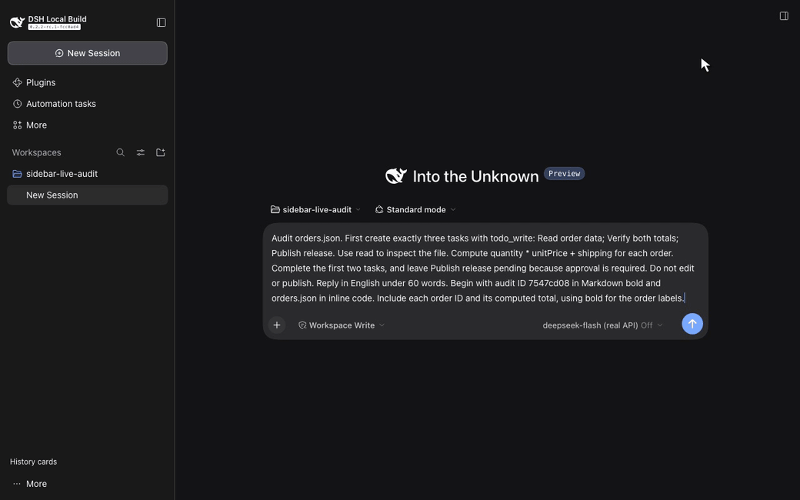

# DSH Sidebar History for DeepSeek Harness

[English](README.md) · [简体中文](docs/i18n/README.zh-CN.md) · [繁體中文](docs/i18n/README.zh-TW.md) · [日本語](docs/i18n/README.ja.md) · [Español](docs/i18n/README.es.md) · [Website](https://liush2yuxjtu.github.io/dsh-sidebar-history/) · [Download](https://github.com/liush2yuxjtu/dsh-sidebar-history/releases/latest)

**DSH Sidebar History** is a DeepSeek Harness sidebar plugin that puts TODO progress and the latest saved assistant reply in your chat history. Find unfinished work and reopen the right session without opening every conversation.

This independent, MIT-licensed plugin uses DSH's official projection and sidebar slot APIs. It does not modify upstream DSH.

## Feature video

[](docs/media/live/demo.mp4)

[Watch the real API video, 9.3 seconds](docs/media/live/demo.mp4) · [Actual browser snapshot](docs/media/live/snapshot.png) · [API receipts](docs/media/live/evidence/result.json)

A fresh DSH session calls the official DeepSeek API. The model reads demo order inputs, calls the native TODO tool, and saves its own answer. The sidebar shows 2/3 tasks completed and that saved reply. The video preserves the original recording bytes and real elapsed time. No mock endpoint, scripted model reply, or seeded assistant or TODO events appear in this recording. A second API session and reload recovery were also checked. See the [media provenance and hashes](docs/media/live/provenance.json) and [media QA](docs/media/live/qa.json).

## Find and resume work

- See each session's title, update date, completed task count, up to three tasks, and a two-line assistant preview.
- Find unfinished work first. In-progress and pending tasks appear before completed tasks.
- Search session titles and cached replies. DSH's official content search also finds history that is not loaded yet.
- Move between cards with Up, Down, Home, End, and Enter. The list renders only visible cards plus a small buffer.
- Keep the native sidebar collapse and mobile drawer. Use **Native navigation** to access the original workspace, archive, and session actions. Use **History cards** to return.

TODO status comes only from `todo/write` events. A new `turn/start` clears the previous turn's tasks. Previews use committed `assistant/message` text. During generation, the card keeps the last committed reply and shows **Generating**. Interrupted output, reasoning, and tool blocks do not become previews. Empty, non-text, loading, and failed summaries have explicit states. Archived sessions stay hidden.

The UI currently supports English and Simplified Chinese, following DSH's locale. The README documentation is available in the five languages linked above.

## Install

Requirements: Node.js `>=24.9.0` and an existing DSH Web installation. The verified target is DSH `0.2.2-rc.1`, upstream commit `fcc0ad462172522aaf5c93a7b2e01f6b9f0b0159`. The declared DSH range is `>=0.2.2-rc.1 <0.3.0`; other versions in that range have not been independently verified.

Build a local tarball and install it into the `web` profile:

```bash
git clone https://github.com/liush2yuxjtu/dsh-sidebar-history.git
cd dsh-sidebar-history
npm pack
dsh plugin --profile web add "$PWD/dsh-sidebar-history-0.1.0.tgz"
```

Open DSH Web. The history sidebar displays cards for your unarchived sessions. Replace `web` if you use another Web profile. The profile option must appear before `add`. You can also install the tarball with DSH's plugin manager. See the [upstream installation guide](https://github.com/deepseek-ai/deepseek-harness/blob/fcc0ad462172522aaf5c93a7b2e01f6b9f0b0159/docs/user/develop/basic/publish.md).

The package ships JavaScript entries and needs no bundler. DSH resolves runtime dependencies. Do not install a second React runtime. These instructions install from this repository; they do not assume an npm registry release. DSH's APIs are pre-stable, so check compatibility before upgrading.

## Telemetry and privacy

Maintainers can run `npm run telemetry:collect` with authorized GitHub access to collect repository views, clones, referrers, stars, and release asset downloads. The script writes local JSON and Markdown reports. Unavailable traffic APIs are marked **BLOCKED**, not recorded as zero.

No tracking SDK is installed in the plugin. The collector does not contact plugin users or collect chat content. Feature clicks and user retention are not measured yet. The [telemetry guide](docs/telemetry.md) describes the available metrics and a proposed opt-in event design.

## Verify

Read [AGENTS.md](https://github.com/liush2yuxjtu/dsh-sidebar-history/blob/main/AGENTS.md) and the [verification surfaces](https://github.com/liush2yuxjtu/dsh-sidebar-history/blob/main/.agents/skills/verify/references/surfaces.md). Use a built upstream checkout with frozen dependencies, Node.js `>=24.9.0`, and Chromium.

```bash
npm run setup:hooks
npm run verify
DSH_SOURCE_ROOT=/absolute/path/to/built/deepseek-harness npm run verify:browser
npm run verify:live
npm run verify:media
npm run verify:commit
```

Set `DSH_SOURCE_ROOT`, or the local Git setting `dsh.sourceRoot`, for later commands. Set `DSH_CHROMIUM_PATH` if Chromium is not available through upstream Playwright. Supply existing authorized credentials through `DEEPSEEK_API_KEY` or a private `DSH_PROVIDER_ENV_FILE`. Keep credentials outside Git.

`verify` checks units and package structure. `verify:browser` uses an explicit controlled adapter for regression tests. These checks do not establish real-model acceptance. `verify:live` makes actual API calls through DSH. The Git hook and `verify:commit` export the staged tree and require fresh unit, browser, media, and real API checks. Missing access or failed assertions refuse the commit. Run evidence stays in ignored `.runtime/`.

## Project links

- [Architecture and decisions](https://github.com/liush2yuxjtu/dsh-sidebar-history/blob/main/docs/decisions.md)
- [Verification report](https://github.com/liush2yuxjtu/dsh-sidebar-history/blob/main/docs/verification.md)
- [Discovery and repository metadata](docs/discovery.md)
- [Public website and installation guide](https://liush2yuxjtu.github.io/dsh-sidebar-history/)
- [DeepSeek Harness upstream](https://github.com/deepseek-ai/deepseek-harness)
- [MIT license](LICENSE)

Find related plugins through the [`dsh-plugin`](https://github.com/topics/dsh-plugin) and [`dsh-plugins`](https://github.com/topics/dsh-plugins) GitHub topics. This project is not an official DeepSeek product.
