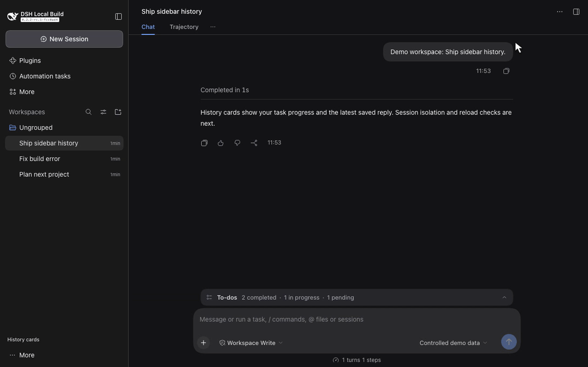

# DSH Sidebar History

An external DeepSeek Harness plugin that shows the current TODO state and latest committed assistant reply in each history card. It uses official projection and slot APIs. It does not modify upstream DSH.

Each card shows its title, update date, completed/total count, up to three tasks, and a two-line assistant preview. Active and pending tasks take precedence over completed tasks. The original sidebar shell keeps its collapse and mobile drawer behavior. Use **Native navigation** at the foot to restore the original workspace browser, including its workspace, archive and session actions; **History cards** returns to this view.

Task state comes only from `todo/write`. A new `turn/start` clears the previous turn's tasks, matching DSH's own TODO lifecycle. The preview comes only from committed `assistant/message` text, excluding interrupted messages, reasoning, tool blocks and uncommitted attempts. While streaming, the card shows Generating and keeps the last committed message. A formally committed message without text displays an explicit non-text state.

The host stores a bounded `sidebarHistory` projection in each session's normal summary. Historical sessions replay their durable logs. Cold cards read projections on demand, with explicit loading and failure states. The client subscribes to the existing session list and renders only the viewport plus overscan; it never retains every historical session. Archived sessions stay hidden. Search combines cached titles and replies with DSH's official content search to locate cold history. Keyboard navigation supports Up, Down, Home, End and Enter.

## Feature video

[](docs/media/demo.mp4)

[Watch the 26-second feature video](docs/media/demo.mp4) · [Original recording](docs/media/raw/gt.mp4) · [Recording and verification notes](examples/0.1.0/example.md)

Switch from native navigation to **History cards**, open another session, and watch TODO progress and the latest saved reply update. The MP4 has five chapters. The preview keeps the full window so the control and result stay in context.

Recorded on Mac mini with plugin `0.1.0` and real DSH `0.2.2-rc.1`. Session text and adapter responses are controlled English demonstration data. No external model call was made. This video verifies the demonstrated UI path, not ongoing production health. [Media QA and hashes](docs/media/qa.json) retain that limit.

## Install

Supported and verified target: DSH `0.2.2-rc.1`, upstream `fcc0ad462172522aaf5c93a7b2e01f6b9f0b0159`. DSH APIs are pre-stable; verify compatibility before changing the version range.

From a checkout, create a tarball with `npm pack`. In the DSH web profile, use its supported plugin manager or `dsh plugin add --help` to install the local package. The bundle patch enables the host projection and its `./client` export supplies the browser module. Dependencies resolve in the DSH installation; do not add a second React runtime. The automated acceptance below installs the package into an isolated real DSH profile through the official profile composition layer.

## Verify

Read [AGENTS.md](AGENTS.md) and the [verification surfaces](.agents/skills/verify/references/surfaces.md).

```bash
npm run verify
DSH_SOURCE_ROOT=/absolute/path/to/built/deepseek-harness npm run verify:browser
```

The browser check requires the upstream frozen dependencies, built Host packages and Web dist, plus Chromium. Set `DSH_CHROMIUM_PATH` to use a system executable, or install the browser associated with upstream Playwright. The runner links missing local test dependencies from that checkout. It runs a real DSH profile, HTTP/WebSocket transport, session persistence, the real TODO tool and browser UI. Its explicit controlled adapter supplies deterministic text and tool calls for streaming checks; it makes no paid model calls and does not claim live model acceptance. Screenshots and raw results are written to ignored `.runtime/browser/`.

The `build` script validates the already distributable JavaScript entries and package references. No bundler is required for DSH's browser-module format.

## Design and acceptance

- [Canonical design and acceptance Page](https://chatgpt.com/space/page_7a28be26236481918ee65d88725c1d38).
- [Architecture and decisions](docs/decisions.md).
- [Verification report](docs/verification.md).
- [DSH upstream](https://github.com/deepseek-ai/deepseek-harness).

The generated concept is a visual reference. Before/after evidence must be captured from the actual DSH browser at the same viewport. Existing DSH navigation, composer, brand and conversation content remain owned by DSH.
