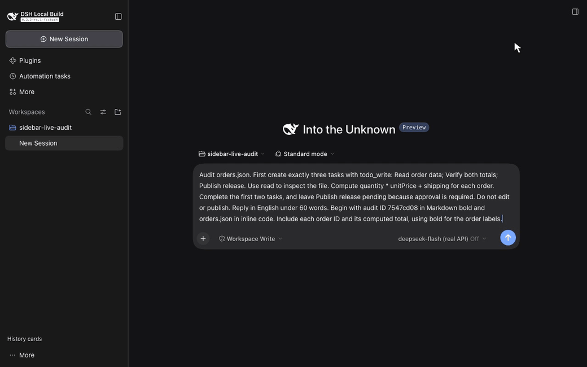

# DSH Sidebar History · DeepSeek Harness 侧栏插件

[English](README.md) · [产品页](https://liush2yuxjtu.github.io/dsh-sidebar-history/zh/) · [真实 API 演示](docs/media/live/demo.mp4)

在 DeepSeek Harness 的历史会话侧栏查看 TODO 进度和最新一条已保存的 Assistant 回复。插件使用官方 projection 与 slot 接口，不修改上游源码。代码使用 [MIT 许可证](LICENSE)。

[](docs/media/live/demo.mp4)

[查看 9.3 秒真实录屏](docs/media/live/demo.mp4) · [浏览器截图](docs/media/live/snapshot.png) · [API 验证证据](docs/media/live/evidence/result.json)

## 功能

- 每张卡片显示会话标题、更新时间、TODO 完成数与总数，最多展示三项任务。进行中与待办任务优先。
- 回复预览最多两行，只使用最新一条正式提交的 Assistant 文本。生成期间保留上一条已保存回复。
- 搜索结合缓存标题、回复与 DSH 官方内容搜索，可查找尚未加载的历史会话。
- 键盘支持方向键、Home、End 和 Enter。列表按可见区域渲染，历史卡片按需读取投影。
- 侧栏保留折叠与手机抽屉。底部 **Native navigation** 可恢复原生工作区浏览器，**History cards** 可返回卡片视图。

TODO 状态来自原生 `todo/write` 事件。新一轮 `turn/start` 会清空上一轮任务。回复来自已提交的 `assistant/message` 文本，排除中断消息、推理内容、工具块和未提交尝试。非文本回复有明确状态。

每个会话的普通摘要中保存有长度限制的 `sidebarHistory` 投影。历史会话重放持久化日志，冷卡片按需读取投影。插件不会为生成卡片而启动每个历史会话的 Agent。归档会话默认隐藏。

## 安装

已验证目标为 DSH `0.2.2-rc.1`，上游 commit 为 `fcc0ad462172522aaf5c93a7b2e01f6b9f0b0159`。插件要求 Node.js `>=24.9.0`。DSH API 尚未稳定，调整版本范围前先验证兼容性。

1. 克隆仓库并生成 tarball。

   ```bash
   git clone https://github.com/liush2yuxjtu/dsh-sidebar-history.git
   cd dsh-sidebar-history
   npm pack
   ```

2. 在 DSH Web Profile 中使用受支持的插件管理器安装本地 tarball。若使用 CLI，先运行 `dsh plugin add --help`，按当前版本说明安装。
3. 打开该 Profile 的历史侧栏，查看卡片。底部 **Native navigation** 可恢复原生工作区导航。

bundle patch 启用 Host 投影，`./client` export 提供浏览器模块。依赖由 DSH 安装环境解析，不要额外加入第二份 React runtime。

## 真实 API 演示的来源

演示使用一个新的 DSH 会话调用官方 DeepSeek API。模型读取生成的演示订单输入，更新原生 TODO，并提交自己的回复。侧栏显示三项任务中的两项已完成，以及实际保存的回答。

视频与截图来自同一次运行。视频保留原始录制字节与实际耗时。验证脚本交叉核对 HTTP response ID、usage、tool-use ID 和持久化消息。录制后还验证了第二次真实 API 会话与刷新恢复。

这段演示不使用脚本模型、预置 Assistant 消息、预置任务事件或 mock endpoint。

- [API 回执与验证结果](docs/media/live/evidence/result.json)
- [媒体来源与哈希](docs/media/live/provenance.json)
- [媒体检查](docs/media/live/qa.json)

## 验证

先读 [AGENTS.md](AGENTS.md) 与[验证范围](.agents/skills/verify/references/surfaces.md)。

```bash
npm run setup:hooks
npm run verify
DSH_SOURCE_ROOT=/absolute/path/to/built/deepseek-harness npm run verify:browser
npm run verify:live
npm run verify:media
npm run verify:commit
```

`verify` 与 `verify:browser` 是单元、构建和受控适配器调试检查，不能代替最终验收。`verify:live` 使用已有授权的 DeepSeek 凭据，发起真实 API 调用。`verify:commit` 与 Git hook 导出暂存内容，运行检查，并要求一次新的真实 API E2E。缺少访问条件时会拒绝提交。

设置 `DSH_SOURCE_ROOT`，或使用本地 Git 配置 `dsh.sourceRoot`。通过 runtime 提供 `DEEPSEEK_API_KEY`，或使用私有 `DSH_PROVIDER_ENV_FILE`。凭据必须保存在仓库外。

浏览器检查需要上游冻结依赖、已构建的 Host 包和 Web dist，以及 Chromium。`DSH_CHROMIUM_PATH` 可指定系统浏览器。受控适配器提供确定性文本与工具调用，仅用于调试，不能作为真实模型验收证据。

## 参考与反馈

- [架构决策](docs/decisions.md)
- [验证报告](docs/verification.md)
- [DeepSeek Harness 上游](https://github.com/deepseek-ai/deepseek-harness)
- [提交问题](https://github.com/liush2yuxjtu/dsh-sidebar-history/issues)

这是独立社区插件。DSH 的原生导航、输入区、品牌和对话内容仍由 DSH 提供。
