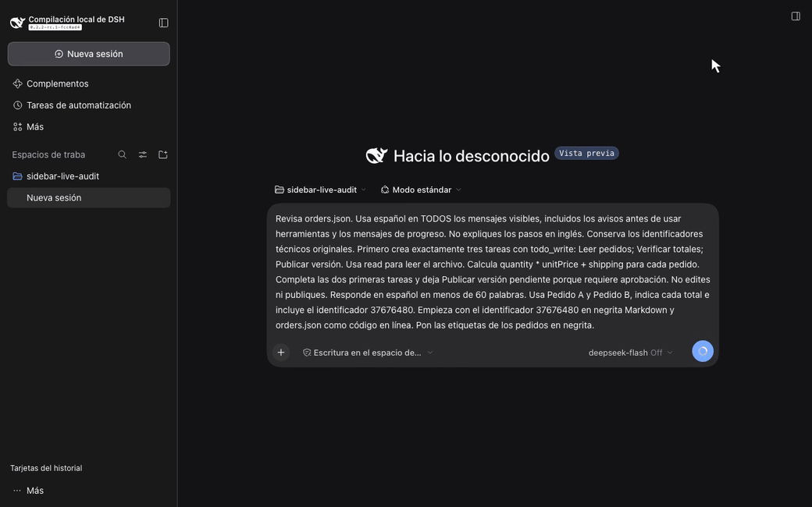

# DSH Sidebar History para DeepSeek Harness

Este checkout compila la versión 0.2.2. Las instrucciones crean el paquete desde este código; el Release publicado puede corresponder a una versión anterior.

[English](../../README.md) · [简体中文](README.zh-CN.md) · [繁體中文](README.zh-TW.md) · [日本語](README.ja.md) · [Español](README.es.md)

**DSH Sidebar History** es un plugin de barra lateral para DeepSeek Harness. Muestra el progreso de las tareas TODO y la última respuesta guardada del asistente en el historial de chat. Encuentra el trabajo pendiente y vuelve a la sesión correcta sin abrir cada conversación.

Es un plugin independiente con licencia MIT. Usa las API oficiales de proyección y de slots de la barra lateral de DSH. No modifica el código de DSH.

## Vídeo de la función

**El material de 0.2.1 supera la verificación en cinco idiomas.** Se comprobaron textos reales, píxeles, procedencia y reproducción. Consulta el [informe de verificación](../verification.md).

[](../media/localized/es/demo.mp4)

[Ver el vídeo con la API real](../media/localized/es/demo.mp4) · [Captura real del navegador](../media/localized/es/snapshot.png) · [Registros de la API](../media/localized/es/evidence/result.json)

La grabación usa una sesión nueva de DSH y la API oficial de DeepSeek. El modelo lee datos de pedidos de demostración, llama a la herramienta TODO nativa y guarda su propia respuesta. La barra lateral muestra 2 de 3 tareas completadas y esa respuesta guardada. El vídeo conserva los bytes de la grabación original y el tiempo real transcurrido. No usa un endpoint mock, respuestas programadas ni mensajes del asistente o eventos TODO insertados de antemano. También se comprobaron una segunda sesión con la API real y la recuperación tras recargar. Consulta la [procedencia y los hashes](../media/localized/es/provenance.json) y la [verificación del material](../media/localized/es/qa.json).

## Encuentra y retoma el trabajo

Cada tarjeta compacta muestra el título, la fecha de actualización, el número de tareas completadas y el total, hasta tres tareas y dos líneas de la última respuesta. Las tareas en curso y pendientes aparecen primero. **Espacios y sesiones archivadas**, al pie, abre las acciones originales de espacios de trabajo, archivo y sesiones de DSH. **Tarjetas del historial** restaura la búsqueda, el desplazamiento y la sesión enfocada. DSH controla la estructura de la barra lateral, el plegado y el panel móvil.

El estado de las tareas procede solo de `todo/write`. Cada nuevo `turn/start` borra las tareas anteriores, igual que el ciclo TODO nativo de DSH. **Respuesta anterior** identifica texto conservado de otro turno. Que el turno actual no tenga una lista de tareas no significa que el trabajo anterior esté terminado. La generación y los estados nativos de parada o error describen el turno actual. Los mensajes vacíos o que solo llaman a herramientas conservan la última respuesta útil. El texto interrumpido, el razonamiento, los resultados de herramientas y los intentos sin confirmar no forman parte de la vista previa.

La vista previa Markdown usa la misma gramática GFM que DSH para negrita, énfasis, tachado y código. Las listas y tablas se convierten en texto compacto; los enlaces muestran su etiqueta y las imágenes, su texto alternativo. La vista de solo lectura no navega, carga imágenes remotas ni interpreta HTML sin procesar. Abre la conversación para ver el formato nativo completo. Las descripciones accesibles incluyen el número de tareas, cada estado, el texto de la respuesta y el contexto del turno.

El host guarda una proyección `sidebarHistory` de tamaño limitado en el resumen normal de cada sesión. La v2 reconstruye checkpoints anteriores desde registros persistentes sin activar Agents históricos. Las tarjetas sin cargar leen la proyección bajo demanda e indican la carga o el error. El cliente dibuja el área visible y un pequeño margen; las sesiones archivadas permanecen ocultas. La búsqueda combina títulos y respuestas en caché con la búsqueda oficial de contenido de DSH. Un error remoto conserva las coincidencias locales, avisa de que los resultados están incompletos y ofrece **Reintentar búsqueda**. También avisa si se alcanza el límite de resultados. Las coincidencias que solo existen en la búsqueda remota y su desplazamiento sobreviven al cambiar de vista y volver. Usa las flechas arriba y abajo, Home, End y Enter.

La barra lateral admite inglés, chino simplificado, chino tradicional, japonés y español según el idioma de DSH. El paquete de chino tradicional para el host cubre 17 namespaces y 1829 claves, incluidas las pantallas de la demostración. Otros namespaces pueden usar chino simplificado. La [procedencia del paquete](../../src/zh-tw-host-provenance.json) registra su alcance.

## Instala el plugin de barra lateral

Necesitas Node.js `>=24.9.0` y una instalación de DSH Web. La versión verificada es DSH `0.2.2-rc.1`, commit de origen `fcc0ad462172522aaf5c93a7b2e01f6b9f0b0159`. El rango declarado es `>=0.2.2-rc.1 <0.3.0`. No se han verificado por separado otras versiones dentro de ese rango.

Crea un tarball local e instálalo en el profile `web`:

```bash
git clone https://github.com/liush2yuxjtu/dsh-sidebar-history.git
cd dsh-sidebar-history
npm pack
dsh plugin --profile web add "$PWD/dsh-sidebar-history-0.2.2.tgz"
```

Abre DSH Web. La barra lateral muestra tarjetas para las sesiones sin archivar. Sustituye `web` si usas otro profile Web. La opción `--profile` debe ir antes de `add`. También puedes instalar el tarball local con el gestor de plugins de DSH. Consulta la [guía de instalación de DSH](https://github.com/deepseek-ai/deepseek-harness/blob/fcc0ad462172522aaf5c93a7b2e01f6b9f0b0159/docs/user/develop/basic/publish.md).

El paquete incluye un módulo de navegador ya compilado. Tras editar `src/client.mjs` y `src/markdown-preview.mjs`, los mantenedores ejecutan `npm run build:client`. `npm run build` rechaza un bundle o un aviso de licencia desactualizado. DSH resuelve las dependencias en tiempo de ejecución. No instales una segunda copia de React. Estas instrucciones instalan desde el repositorio y no presuponen una publicación en npm registry. Las API de DSH aún no son estables. Comprueba la compatibilidad antes de actualizar.

## Telemetría y privacidad

Los mantenedores pueden ejecutar `npm run telemetry:collect` con acceso autorizado a GitHub. El script obtiene visitas al repositorio, clones, sitios de referencia, estrellas y descargas de archivos de Release. Genera informes locales en JSON y Markdown. Las API de tráfico no disponibles se marcan como **BLOCKED**, no como cero.

El plugin no instala un SDK de seguimiento. El script no contacta con los usuarios del plugin ni recopila el contenido del chat. Los clics en funciones y la retención de usuarios aún no se miden. La [guía de telemetría](../telemetry.md) describe las métricas disponibles y un diseño propuesto de eventos con consentimiento.

## Verifica un cambio

Lee [AGENTS.md](https://github.com/liush2yuxjtu/dsh-sidebar-history/blob/main/AGENTS.md) y la [lista de verificaciones](https://github.com/liush2yuxjtu/dsh-sidebar-history/blob/main/.agents/skills/verify/references/surfaces.md). Necesitas un checkout de DSH compilado con sus dependencias fijadas, Node.js `>=24.9.0` y Chromium.

```bash
npm run setup:hooks
npm run verify
DSH_SOURCE_ROOT=/absolute/path/to/built/deepseek-harness npm run verify:browser
npm run verify:live
npm run verify:media
npm run verify:commit
```

Configura `DSH_SOURCE_ROOT`, o el ajuste local de Git `dsh.sourceRoot`, para los comandos posteriores. Configura `DSH_CHROMIUM_PATH` si Chromium no está disponible mediante Playwright de DSH. Usa credenciales ya autorizadas mediante `DEEPSEEK_API_KEY` o un archivo privado `DSH_PROVIDER_ENV_FILE`. Mantén las credenciales fuera de Git.

`verify` comprueba las pruebas unitarias y la estructura del paquete. `verify:browser` usa un adapter controlado y explícito para las pruebas de regresión. Estas comprobaciones no demuestran la aceptación con un modelo real. `verify:live` llama a la API real mediante DSH. El hook de Git y `verify:commit` exportan los archivos preparados y exigen nuevas comprobaciones unitarias, de navegador, de material y de API real. Si falta acceso o falla una aserción, rechazan el commit. Las pruebas de ejecución se guardan en `.runtime/`, que Git ignora.

## Enlaces del proyecto

- [Arquitectura y decisiones](https://github.com/liush2yuxjtu/dsh-sidebar-history/blob/main/docs/decisions.md)
- [Informe de verificación](https://github.com/liush2yuxjtu/dsh-sidebar-history/blob/main/docs/verification.md)
- [Descubrimiento y metadatos del repositorio](../discovery.md)
- [DeepSeek Harness](https://github.com/deepseek-ai/deepseek-harness)
- [Licencia MIT](../../LICENSE)

Encuentra plugins relacionados en los temas [`dsh-plugin`](https://github.com/topics/dsh-plugin) y [`dsh-plugins`](https://github.com/topics/dsh-plugins) de GitHub. Este proyecto no es un producto oficial de DeepSeek.
