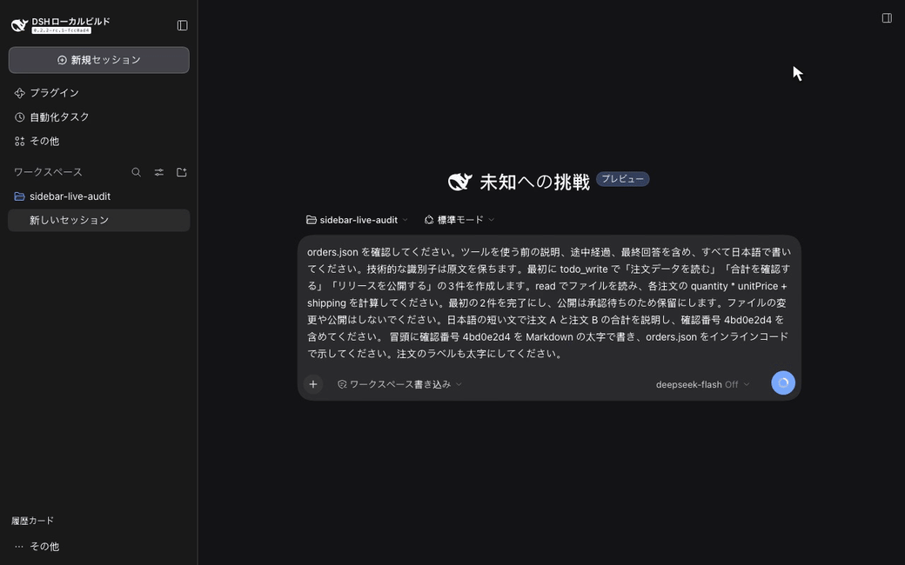

# DSH Sidebar History：DeepSeek Harness の履歴サイドバープラグイン

この checkout は 0.2.1 をビルドします。以下の手順は現在のソースからパッケージを作成します。公開済みの Release は古い場合があります。

[English](../../README.md) · [简体中文](README.zh-CN.md) · [繁體中文](README.zh-TW.md) · [日本語](README.ja.md) · [Español](README.es.md)

**DSH Sidebar History** は、DeepSeek Harness のチャット履歴に TODO の進捗と最後に保存された Assistant の返信を表示するプラグインです。会話を一つずつ開かずに、未完了の作業を見つけて再開できます。

MIT ライセンスの独立したプラグインです。DSH の公式 projection API とサイドバーの slot API を使い、上流の DSH ソースコードは変更しません。

## 機能の動画

**0.2.1 の5言語メディア検証に合格しました。** 実際の文字、画面、出典、動画再生を確認しました。[検証レポート](../verification.md)をご覧ください。

[](../media/localized/ja/demo.mp4)

[実 API による動画を見る](../media/localized/ja/demo.mp4) · [実際のブラウザー画像](../media/localized/ja/snapshot.png) · [API の実行記録](../media/localized/ja/evidence/result.json)

新しい DSH セッションから DeepSeek 公式 API を呼び出して録画しました。モデルはデモ用の注文データを読み、標準 TODO ツールを呼び出し、自分の回答を保存します。サイドバーには 3 件中 2 件の完了と保存済みの返信が表示されます。動画は元の録画データと実際の経過時間を保持しています。mock エンドポイント、台本によるモデルの返信、事前に挿入した Assistant メッセージや TODO イベントは使っていません。別の実 API セッションと再読み込み後の復元も確認済みです。[出所とハッシュ](../media/localized/ja/provenance.json)、[メディアの検証結果](../media/localized/ja/qa.json)を参照してください。

## 作業を見つけて再開する

各カードはタイトル、更新日、完了数と総数、最大 3 件のタスク、2 行の返信プレビューを表示します。進行中と保留中のタスクを先に表示します。下部の **ワークスペースとアーカイブ** で、DSH 標準のワークスペース、アーカイブ、セッション操作を開きます。**履歴カード** に戻ると、検索語、スクロール位置、選択中のセッションを復元します。サイドバーの外枠、折りたたみ、モバイル用ドロワーは DSH が管理します。

タスクの状態は `todo/write` だけから取得します。新しい `turn/start` は、DSH 標準の TODO ライフサイクルと同じく前のターンのタスクを消去します。**以前の返信** という表示は、過去のターンのテキストを保持していることを示します。現在のターンにタスク一覧がないことは、以前の作業の完了を意味しません。生成中、標準の停止、失敗の状態は現在のターンを示します。ツールのみのメッセージや空のメッセージは、有用な最新の返信を置き換えません。中断された出力、推論、ツールの結果、未確定の試行はプレビューになりません。

Markdown プレビューは DSH と同じ GFM 文法で、太字、強調、取り消し線、コードを表示します。リストと表は短い読みやすいテキストにし、リンクはラベル、画像は代替テキストを表示します。読み取り専用のため、ページ移動、外部画像の取得、生の HTML の解釈は行いません。完全な表示は会話で確認できます。アクセシビリティ用の説明にはタスク数、各状態、返信、ターンの文脈が含まれます。

ホストは各セッションの通常の要約に、サイズを制限した `sidebarHistory` projection を保存します。v2 は永続ログから古いチェックポイントを再構築し、過去の Agent を起動しません。未読み込みのカードは必要なときに projection を取得し、読み込み中と失敗を明示します。表示領域と少量の予備だけを描画し、アーカイブ済みセッションは非表示にします。検索はキャッシュ済みのタイトルと返信、DSH 公式の内容検索を組み合わせます。リモート検索に失敗してもローカル結果を残し、不完全な結果であることと **再検索** の操作を示します。検索上限に達した場合も通知します。リモート検索だけで見つかった結果とスクロール位置も、画面を往復して保持します。上下矢印、Home、End、Enter キーで操作できます。

サイドバーは英語、簡体字中国語、繁体字中国語、日本語、スペイン語に対応し、DSH の言語設定に従います。繁体字の標準画面用パックは 17 namespace、1829 key を含み、デモ画面を対象とします。対象外の namespace は簡体字に戻る場合があります。[言語パックの出所](../../src/zh-tw-host-provenance.json)に範囲を記録しています。

## サイドバープラグインをインストールする

Node.js `>=24.9.0` と、インストール済みの DSH Web が必要です。検証済みの対象は DSH `0.2.2-rc.1`、上流 commit `fcc0ad462172522aaf5c93a7b2e01f6b9f0b0159` です。宣言した DSH の範囲は `>=0.2.2-rc.1 <0.3.0` です。範囲内の他のバージョンは個別に検証していません。

ローカルの tarball を作成し、`web` profile にインストールします。

```bash
git clone https://github.com/liush2yuxjtu/dsh-sidebar-history.git
cd dsh-sidebar-history
npm pack
dsh plugin --profile web add "$PWD/dsh-sidebar-history-0.2.1.tgz"
```

DSH Web を開くと、アーカイブされていないセッションの履歴カードが表示されます。別の Web profile を使う場合は `web` を置き換えてください。`--profile` は `add` より前に指定します。DSH のプラグインマネージャーからローカル tarball をインストールすることもできます。[上流のインストールガイド](https://github.com/deepseek-ai/deepseek-harness/blob/fcc0ad462172522aaf5c93a7b2e01f6b9f0b0159/docs/user/develop/basic/publish.md)を参照してください。

ビルド済みのブラウザーモジュールを同梱しています。メンテナーは `src/client.mjs` と `src/markdown-preview.mjs` を編集した後、`npm run build:client` を実行します。`npm run build` は古い bundle やライセンス表記を拒否します。実行時の依存関係は DSH が解決します。React を別途追加しないでください。この手順はリポジトリからのインストールであり、npm registry での公開を前提としません。DSH API はまだ安定していないため、更新前に互換性を確認してください。

## テレメトリーとプライバシー

メンテナーは、認可済みの GitHub アクセスを使って `npm run telemetry:collect` を実行できます。リポジトリの閲覧、clone、参照元、Star 数、Release 添付ファイルのダウンロード数を取得し、ローカルに JSON と Markdown のレポートを保存します。利用できないトラフィック API はゼロではなく **BLOCKED** と記録します。

プラグインに追跡用 SDK は導入しません。収集スクリプトはプラグイン利用者に接続せず、会話内容も収集しません。機能のクリック数とユーザー継続率はまだ測定していません。[テレメトリーガイド](../telemetry.md)に、取得できる指標と、利用者の同意に基づくイベント収集の設計案を記載しています。

## 変更を検証する

[AGENTS.md](https://github.com/liush2yuxjtu/dsh-sidebar-history/blob/main/AGENTS.md) と[検証項目](https://github.com/liush2yuxjtu/dsh-sidebar-history/blob/main/.agents/skills/verify/references/surfaces.md)を先に確認してください。固定された依存関係でビルドした上流 checkout、Node.js `>=24.9.0`、Chromium が必要です。

```bash
npm run setup:hooks
npm run verify
DSH_SOURCE_ROOT=/absolute/path/to/built/deepseek-harness npm run verify:browser
npm run verify:live
npm run verify:media
npm run verify:commit
```

後続のコマンドに `DSH_SOURCE_ROOT`、またはローカル Git 設定 `dsh.sourceRoot` を設定します。上流 Playwright で Chromium を利用できない場合は `DSH_CHROMIUM_PATH` を設定します。認可済みの認証情報を `DEEPSEEK_API_KEY`、または非公開の `DSH_PROVIDER_ENV_FILE` で渡してください。認証情報を Git に保存しないでください。

`verify` は単体テストとパッケージ構造を確認します。`verify:browser` は明示された制御用 adapter で回帰テストを実行します。これらだけでは実モデルによる受け入れ検証になりません。`verify:live` は DSH から実 API を呼び出します。Git hook と `verify:commit` はステージされた内容を取り出し、単体、ブラウザー、メディア、実 API の各検証を毎回実行します。アクセスできない場合や assertion に失敗した場合は commit を拒否します。実行記録は Git の対象外である `.runtime/` に保存します。

## プロジェクトのリンク

- [アーキテクチャーと設計判断](https://github.com/liush2yuxjtu/dsh-sidebar-history/blob/main/docs/decisions.md)
- [検証レポート](https://github.com/liush2yuxjtu/dsh-sidebar-history/blob/main/docs/verification.md)
- [公開検索とリポジトリ情報](../discovery.md)
- [DeepSeek Harness 上流](https://github.com/deepseek-ai/deepseek-harness)
- [MIT ライセンス](../../LICENSE)

関連するプラグインは GitHub の [`dsh-plugin`](https://github.com/topics/dsh-plugin) と [`dsh-plugins`](https://github.com/topics/dsh-plugins) トピックから探せます。このプロジェクトは DeepSeek の公式製品ではありません。
