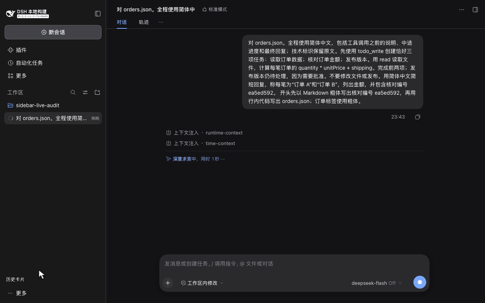

# DSH Sidebar History：DeepSeek Harness 历史侧栏插件

[English](../../README.md) · [简体中文](README.zh-CN.md) · [繁體中文](README.zh-TW.md) · [日本語](README.ja.md) · [Español](README.es.md)

**DSH Sidebar History** 在 DeepSeek Harness 的聊天历史侧栏中显示 TODO 进度和最新一条已保存的 Assistant 回复。你可以先找到未完成的工作，再打开对应会话，无需逐个检查聊天记录。

这是一个采用 MIT 许可证的独立插件。它使用 DSH 官方投影和侧栏插槽 API，不修改上游 DSH 源码。

## 功能视频

[](../media/localized/zh-CN/demo.mp4)

[观看真实 API 视频](../media/localized/zh-CN/demo.mp4) · [实际浏览器截图](../media/localized/zh-CN/snapshot.png) · [API 回执](../media/localized/zh-CN/evidence/result.json)

全新的 DSH 会话调用 DeepSeek 官方 API。模型读取演示订单输入，调用原生 TODO 工具，并保存自己的回答。侧栏显示 2/3 项任务已完成，以及该会话保存的回复。视频保留原始录制字节和真实时长。录制中没有 mock 接口、脚本回复，也没有预先写入 Assistant 消息或 TODO 事件。另一个真实 API 会话和刷新恢复也已检查。参见[媒体来源与哈希](../media/localized/zh-CN/provenance.json)和[媒体检查结果](../media/localized/zh-CN/qa.json)。

## 查找并继续工作

- 每张卡片显示会话标题、更新时间、任务完成数、最多三项任务，以及两行 Assistant 摘要。
- 优先显示进行中和待处理任务，再显示已完成任务。
- 搜索会话标题和已缓存的回复。DSH 官方内容搜索还可以查找尚未加载的历史。
- 使用上、下、Home、End 和 Enter 键操作卡片。列表只渲染可见卡片和少量缓冲区。
- 保留原生侧栏折叠和手机抽屉。点击**原生导航**可以访问原有工作区、归档和会话操作。点击**历史卡片**返回卡片视图。

TODO 状态只来自 `todo/write` 事件。新的 `turn/start` 会清空上一轮任务。摘要只使用已提交的 `assistant/message` 文本。生成期间，卡片保留上一条已提交回复，并显示**生成中**。中断输出、推理和工具块不会成为摘要。空回复、非文本消息、加载中和加载失败都有明确状态。已归档的会话默认隐藏。

侧栏支持英文、简体中文、繁体中文、日语和西班牙语，跟随 DSH 的语言设置。繁体中文覆盖侧栏及示范画面，其他 DSH 页面可能回退为简体中文。

## 安装侧栏插件

需要 Node.js `>=24.9.0` 和已安装的 DSH Web。已验证的目标为 DSH `0.2.2-rc.1`，上游 commit 为 `fcc0ad462172522aaf5c93a7b2e01f6b9f0b0159`。声明的 DSH 范围为 `>=0.2.2-rc.1 <0.3.0`；范围内的其他版本尚未单独验证。

创建本地安装包，并安装到 `web` profile：

```bash
git clone https://github.com/liush2yuxjtu/dsh-sidebar-history.git
cd dsh-sidebar-history
npm pack
dsh plugin --profile web add "$PWD/dsh-sidebar-history-0.1.1.tgz"
```

打开 DSH Web。历史侧栏会为未归档的会话显示卡片。如果你使用其他 Web profile，请替换 `web`。`--profile` 参数必须放在 `add` 前。也可以通过 DSH 插件管理器安装本地包。参见[上游安装指南](https://github.com/deepseek-ai/deepseek-harness/blob/fcc0ad462172522aaf5c93a7b2e01f6b9f0b0159/docs/user/develop/basic/publish.md)。

安装包已包含 JavaScript 入口，无需 bundler。运行时依赖由 DSH 解析。不要再安装第二份 React。这些命令从本仓库安装，不依赖 npm registry 上已有发布版本。DSH API 尚未稳定，升级前请检查兼容性。

## 遥测与隐私

维护者可以使用已有授权的 GitHub 访问，运行 `npm run telemetry:collect`，采集仓库访问、克隆、来源网站、Star 数和 Release 附件下载数。脚本生成本地 JSON 和 Markdown 报告。无法读取的流量 API 标记为 **BLOCKED**，不会记为零。

插件不安装追踪 SDK。采集脚本不联系插件用户，也不采集聊天内容。目前尚未测量功能点击和用户留存。[遥测指南](../telemetry.md)列出已有指标和拟议的自愿参与事件设计。

## 验证修改

先读 [AGENTS.md](https://github.com/liush2yuxjtu/dsh-sidebar-history/blob/main/AGENTS.md) 和[验证清单](https://github.com/liush2yuxjtu/dsh-sidebar-history/blob/main/.agents/skills/verify/references/surfaces.md)。需要已构建的上游 checkout、冻结依赖、Node.js `>=24.9.0` 和 Chromium。

```bash
npm run setup:hooks
npm run verify
DSH_SOURCE_ROOT=/absolute/path/to/built/deepseek-harness npm run verify:browser
npm run verify:live
npm run verify:media
npm run verify:commit
```

为后续命令设置 `DSH_SOURCE_ROOT`，或设置本地 Git 配置 `dsh.sourceRoot`。如果上游 Playwright 中没有可用的 Chromium，请设置 `DSH_CHROMIUM_PATH`。通过 `DEEPSEEK_API_KEY` 或私有的 `DSH_PROVIDER_ENV_FILE` 提供已有授权凭据。不要将凭据写入 Git。

`verify` 检查单元测试和包结构。`verify:browser` 使用明确标注的受控 adapter 做回归测试。这两项不能证明真实模型验收通过。`verify:live` 通过 DSH 调用真实 API。Git hook 和 `verify:commit` 会导出暂存区，并要求重新完成单元、浏览器、媒体和真实 API 检查。缺少访问权限或断言失败时拒绝提交。运行证据保存在忽略提交的 `.runtime/` 中。

## 项目链接

- [架构与决策](https://github.com/liush2yuxjtu/dsh-sidebar-history/blob/main/docs/decisions.md)
- [验证报告](https://github.com/liush2yuxjtu/dsh-sidebar-history/blob/main/docs/verification.md)
- [发现入口与仓库元数据](../discovery.md)
- [DeepSeek Harness 上游](https://github.com/deepseek-ai/deepseek-harness)
- [MIT 许可证](../../LICENSE)

可通过 GitHub 的 [`dsh-plugin`](https://github.com/topics/dsh-plugin) 和 [`dsh-plugins`](https://github.com/topics/dsh-plugins) 主题查找相关插件。本项目不是 DeepSeek 官方产品。
