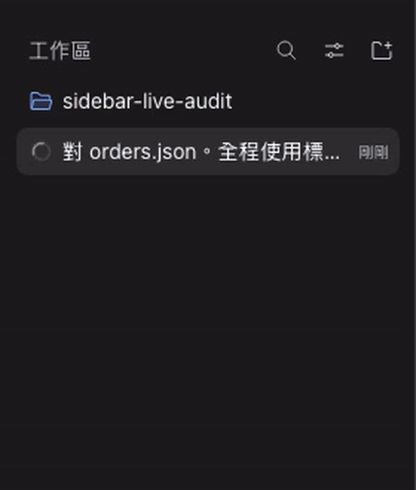

# DSH Sidebar History：DeepSeek Harness 歷史側欄外掛

此 checkout 建置 0.2.3；下方指令從目前原始碼建立安裝包，已發佈的 Release 可能仍是較早版本。

[English](../../README.md) · [简体中文](README.zh-CN.md) · [繁體中文](README.zh-TW.md) · [日本語](README.ja.md) · [Español](README.es.md)

**DSH Sidebar History** 在 DeepSeek Harness 的聊天歷史側欄中顯示 TODO 進度和最新一則已儲存的 Assistant 回覆。你可以先找到未完成的工作，再開啟對應對話，無需逐一檢查聊天記錄。

這是採用 MIT 授權的獨立外掛。它使用 DSH 官方投影和側欄插槽 API，不修改上游 DSH 原始碼。

## 看清已完成與待處理的任務

訂單核對正在執行，原側欄只顯示會話標題。開啟 **歷史卡片**，卡片進度從 **0/3** 變為 **2/3**，並顯示模型儲存的正式回覆。「發佈版本」仍待處理。8 秒進度預覽是側欄的連續裁切，保留實際速度。完整影片展示歷史入口操作和完整回覆。

**已歸檔的真實 API 進度故事。** 錄製回執中的套件雜湊符合 0.2.2。 下方另附目前 0.2.3 的真實 API 錄影與驗證。

[](../media/localized/zh-TW/story-source-04f2e81-snapshot/raw/gt.mp4)

[安裝側欄外掛](#安裝側欄外掛)

[完整畫面來源片段（0.2.2）](../media/localized/zh-TW/story-source-04f2e81-snapshot/feature-8s.gif) · [MP4](../media/localized/zh-TW/story-source-04f2e81-snapshot/raw/gt.mp4)

**0.2.3 五語媒體驗證通過。** 五套素材已通過真實文字、像素、來源與播放檢查，請參閱[驗證報告](../verification.md)。

[8 秒完整畫面預覽](../media/localized/zh-TW/feature-8s.gif)

[觀看真實 API 影片](../media/localized/zh-TW/demo.mp4) · [實際瀏覽器截圖](../media/localized/zh-TW/snapshot.png) · [API 回執](../media/localized/zh-TW/evidence/result.json)

全新的 DSH 對話呼叫 DeepSeek 官方 API。模型讀取示範訂單輸入，呼叫原生 TODO 工具，並儲存自己的回答。側欄顯示 2/3 項任務已完成，以及該對話儲存的回覆。影片保留原始錄製位元組和實際時長。錄製中沒有 mock 端點、腳本回覆，也沒有預先寫入 Assistant 訊息或 TODO 事件。另一個真實 API 對話和重新整理後的恢復也已檢查。請參閱[媒體來源與雜湊](../media/localized/zh-TW/provenance.json)和[媒體檢查結果](../media/localized/zh-TW/qa.json)。

[安裝側欄外掛](#安裝側欄外掛) · [故事與來源紀錄](../media/story-first.md)

## 尋找並繼續工作

每張精簡卡片顯示對話標題、更新時間、完成數與總數、最多三項任務，以及兩行 Assistant 預覽。進行中和待處理任務優先。按底部 **工作區與歸檔**，可使用 DSH 原有工作區、歸檔和對話操作；按 **歷史卡片** 返回時，搜尋文字、捲動位置及聚焦對話保持不變。DSH 繼續控制側欄外殼、收合及行動版抽屜。

任務狀態只來自 `todo/write`。新的 `turn/start` 會清空上一輪任務，與 DSH 原生 TODO 生命週期一致。**先前回覆** 標記表示保留的是先前輪次文字；**本輪尚無任務清單**，不代表上一輪工作已完成。產生中、原生停止或失敗狀態描述目前輪次。純工具訊息或空訊息會保留最新的有用文字。中斷輸出、推理、工具結果及未提交的嘗試不會成為預覽。

Markdown 預覽使用與 DSH 相同的 GFM 語法，顯示粗體、斜體、刪除線及程式碼。清單與表格縮為可讀文字，連結顯示標籤，圖片顯示替代文字。唯讀預覽不會跳轉、載入遠端圖片或解讀原始 HTML；完整格式請在對話中查看。無障礙描述包含任務數量、各項狀態、回覆文字及輪次脈絡。

宿主在各對話的一般摘要中儲存有長度限制的 `sidebarHistory` 投影。v2 可從持久化記錄重播舊檢查點，無需啟動歷史 Agent。尚未載入的卡片按需讀取投影，並明確顯示載入或失敗狀態。用戶端只繪製可見區域及少量緩衝；已歸檔對話保持隱藏。搜尋結合快取標題、回覆及 DSH 官方內容搜尋。遠端搜尋失敗時保留本機結果，說明結果不完整，並提供 **重試搜尋**；達到內容搜尋上限時也會顯示提示。僅遠端符合的結果及其捲動位置，在導覽往返後保留。支援上、下、Home、End 及 Enter 鍵。

側欄支援英文、簡體中文、繁體中文、日語及西班牙語，跟隨 DSH 的語言設定。繁體中文原生宿主語言包涵蓋 17 個 namespace、1829 個 key，包含示範畫面；其他 namespace 可能回退為簡體中文。[語言包來源](../../src/zh-tw-host-provenance.json)記錄來源與範圍。

## 安裝側欄外掛

需要 Node.js `>=24.9.0` 和已安裝的 DSH Web。已驗證的目標為 DSH `0.2.2-rc.1`，上游 commit 為 `fcc0ad462172522aaf5c93a7b2e01f6b9f0b0159`。宣告的 DSH 範圍為 `>=0.2.2-rc.1 <0.3.0`；範圍內的其他版本尚未個別驗證。

建立本機安裝包，並安裝至 `web` profile：

```bash
git clone https://github.com/liush2yuxjtu/dsh-sidebar-history.git
cd dsh-sidebar-history
npm pack
dsh plugin --profile web add "$PWD/dsh-sidebar-history-0.2.3.tgz"
```

開啟 DSH Web。歷史側欄會為未歸檔的對話顯示卡片。如果你使用其他 Web profile，請替換 `web`。`--profile` 參數必須放在 `add` 前。也可以透過 DSH 外掛管理員安裝本機包。請參閱[上游安裝指南](https://github.com/deepseek-ai/deepseek-harness/blob/fcc0ad462172522aaf5c93a7b2e01f6b9f0b0159/docs/user/develop/basic/publish.md)。

安裝包包含預先建置的瀏覽器模組。維護者修改 `src/client.mjs` 和 `src/markdown-preview.mjs` 後，執行 `npm run build:client`；`npm run build` 會拒絕過期的 bundle 或授權聲明。執行階段相依套件由 DSH 解析。不要再安裝第二份 React。這些指令從本儲存庫安裝，不依賴 npm registry 已有發佈版本。DSH API 尚未穩定，升級前請檢查相容性。

## 遙測與隱私

維護者可以使用已有授權的 GitHub 存取權，執行 `npm run telemetry:collect`，收集儲存庫瀏覽、複製、來源網站、Star 數和 Release 附件下載數。腳本產生本機 JSON 和 Markdown 報告。無法讀取的流量 API 標記為 **BLOCKED**，不會記為零。

側欄底部的「使用統計」預設關閉。明確開啟後，向 Supabase 傳送固定操作名稱、版本、介面語言與隨機事件編號；不傳送聊天、TODO、搜尋詞、對話或安裝識別碼。支援瀏覽器隱私偏好、關閉與清除設定，並顯示接收結果。儲存 30 天。指標是事件數，不能代表獨立使用者或留存；託管平台可觀察網路中繼資料。詳見[遙測指南](../telemetry.md)。

## 驗證修改

先讀 [AGENTS.md](https://github.com/liush2yuxjtu/dsh-sidebar-history/blob/main/AGENTS.md) 和[驗證清單](https://github.com/liush2yuxjtu/dsh-sidebar-history/blob/main/.agents/skills/verify/references/surfaces.md)。需要已建置的上游 checkout、凍結相依套件、Node.js `>=24.9.0` 和 Chromium。

```bash
npm run setup:hooks
npm run verify
DSH_SOURCE_ROOT=/absolute/path/to/built/deepseek-harness npm run verify:browser
npm run verify:live
npm run verify:media
npm run verify:commit
```

為後續指令設定 `DSH_SOURCE_ROOT`，或設定本機 Git 組態 `dsh.sourceRoot`。如果上游 Playwright 中沒有可用的 Chromium，請設定 `DSH_CHROMIUM_PATH`。透過 `DEEPSEEK_API_KEY` 或私有的 `DSH_PROVIDER_ENV_FILE` 提供已有授權憑證。不要將憑證寫入 Git。

`verify` 檢查單元測試和包結構。`verify:browser` 使用明確標示的受控 adapter 做迴歸測試。這兩項不能證明真實模型驗收通過。`verify:live` 透過 DSH 呼叫真實 API。Git hook 和 `verify:commit` 會匯出暫存區，並要求重新完成單元、瀏覽器、媒體和真實 API 檢查。缺少存取權限或斷言失敗時拒絕提交。執行證據保存在忽略提交的 `.runtime/` 中。

## 專案連結

- [架構與決策](https://github.com/liush2yuxjtu/dsh-sidebar-history/blob/main/docs/decisions.md)
- [驗證報告](https://github.com/liush2yuxjtu/dsh-sidebar-history/blob/main/docs/verification.md)
- [發現入口與儲存庫中繼資料](../discovery.md)
- [DeepSeek Harness 上游](https://github.com/deepseek-ai/deepseek-harness)
- [MIT 授權](../../LICENSE)

可透過 GitHub 的 [`dsh-plugin`](https://github.com/topics/dsh-plugin) 和 [`dsh-plugins`](https://github.com/topics/dsh-plugins) 主題尋找相關外掛。本專案不是 DeepSeek 官方產品。
